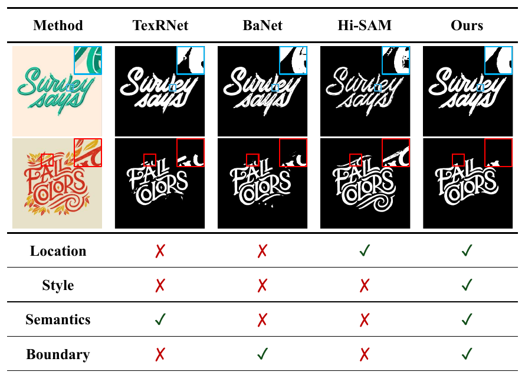
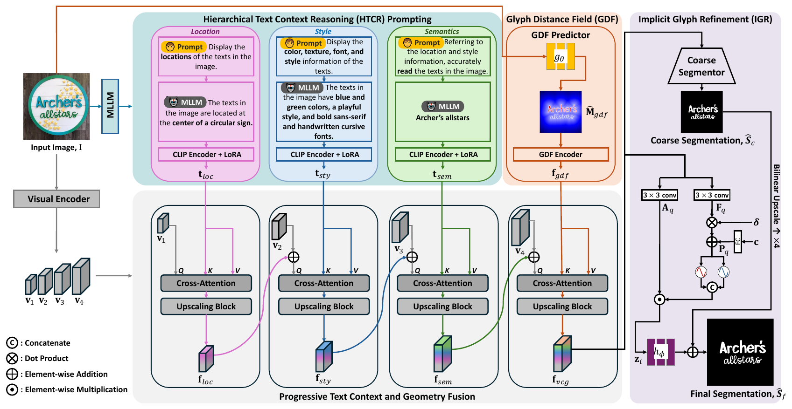
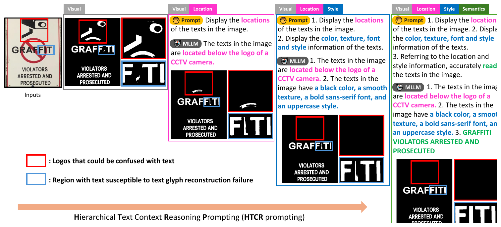
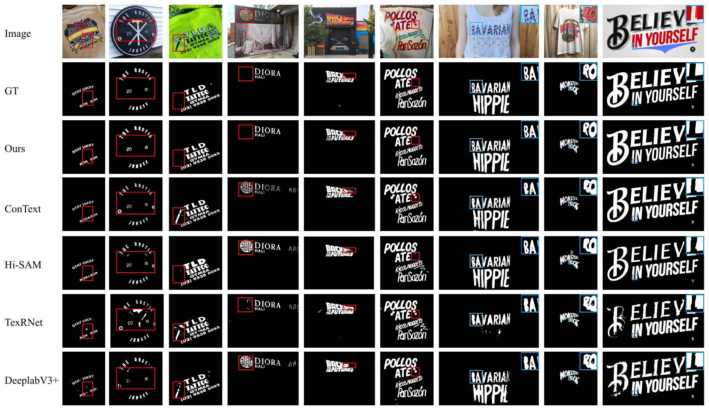

# [IEEE TIP] Language-Guided Scene Text Segmentation via Hierarchical Text Context Reasoning and Implicit Glyph Refinement

Ho Jun Kim, Hak Gu Kim

Official implementation of **LaTeX-Seg** (**La**nguage-driven scene **TeX**t **Seg**mentation), built on [detectron2](https://github.com/facebookresearch/detectron2).

> **Code will be fully released upon publication.**

  

Scene text is hard to segment from visual cues alone: stylized glyphs, logo-like distractors and thin boundaries
confuse existing models. LaTeX-Seg asks a multimodal LLM *where* the text is, *how* it looks and *what* it says,
and uses these answers, together with an explicit glyph geometry representation, to guide segmentation.

## Method

  

- **Hierarchical Text Context Reasoning (HTCR)** prompts an MLLM for three levels of context: **location**,
  **style** and **semantics** (the recognized text). Each answer is encoded token-wise by a CLIP text encoder.
- **Glyph Distance Field (GDF)**: a SIREN predictor gives every pixel its distance to the nearest text boundary,
  a geometry-aware representation of the glyph shape.
- **Progressive Text Context and Geometry Fusion**: the three text contexts and the GDF feature are injected into
  the multi-scale visual features by cross-attention, coarse to fine.
- **Implicit Glyph Refinement (IGR)** refines the coarse segmentation with an implicit, coordinate-based decoder
  to recover thin strokes and sharp boundaries.

  

<em>HTCR: location suppresses distant logo patterns, style removes text-like background,
semantics recovers complete text regions.</em>

## Results

Foreground IoU / F-score (from the paper):

| Method | ICDAR13 FgIoU | ICDAR13 F | Total-Text FgIoU | Total-Text F | TextSeg FgIoU | TextSeg F |
|---|---|---|---|---|---|---|
| Hi-SAM | – | – | 84.86 | 89.68 | 88.96 | 93.87 |
| ConText | 75.90 | 87.30 | 85.19 | 91.90 | 89.74 | 94.60 |
| **LaTeX-Seg** | **76.32** | 86.51 | **85.66** | **92.28** | **90.23** | **94.86** |

Boundary IoU / boundary F-score:

| Method | ICDAR13 BIoU | ICDAR13 BF | Total-Text BIoU | Total-Text BF | TextSeg BIoU | TextSeg BF |
|---|---|---|---|---|---|---|
| Hi-SAM | 68.74 | 75.33 | 81.33 | 90.00 | 86.81 | 93.11 |
| ConText | 68.90 | 75.41 | 81.20 | 89.93 | 86.26 | 92.62 |
| **LaTeX-Seg** | **69.89** | **75.89** | **81.72** | **90.24** | **87.80** | **93.63** |

  

## License

Apache License 2.0 (see `LICENSE`). Parts of the code are adapted from [detectron2](https://github.com/facebookresearch/detectron2) (Apache-2.0).
